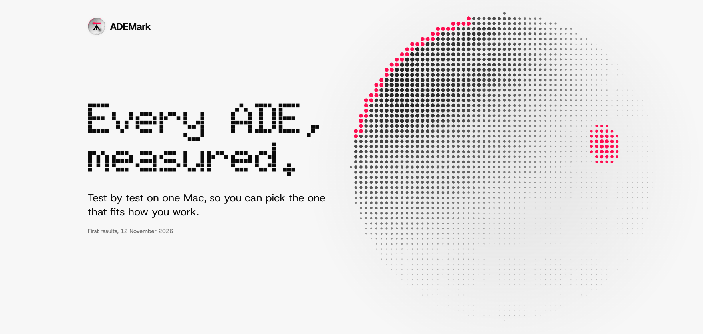
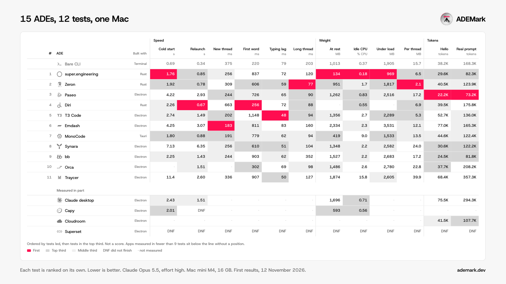
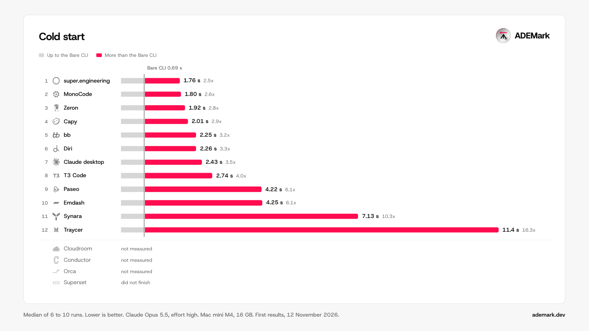
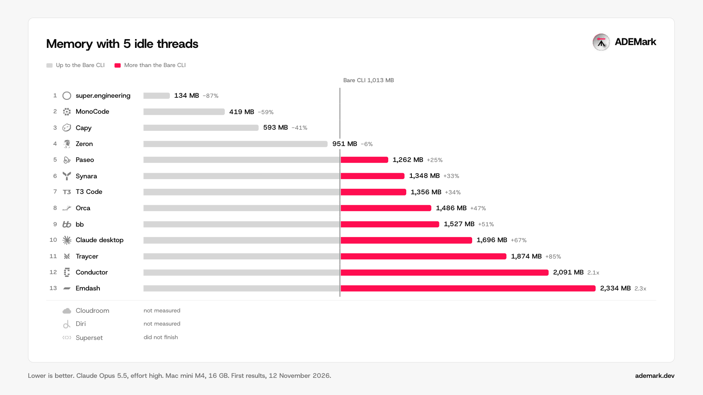
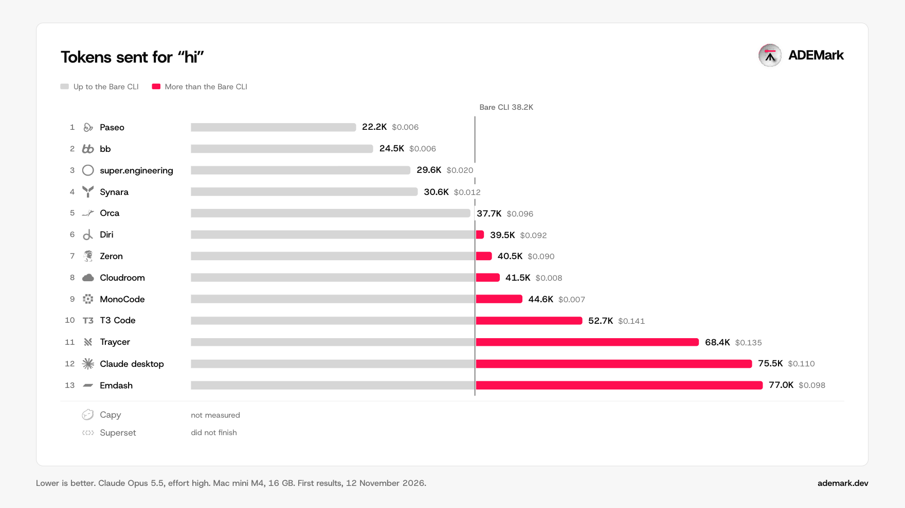
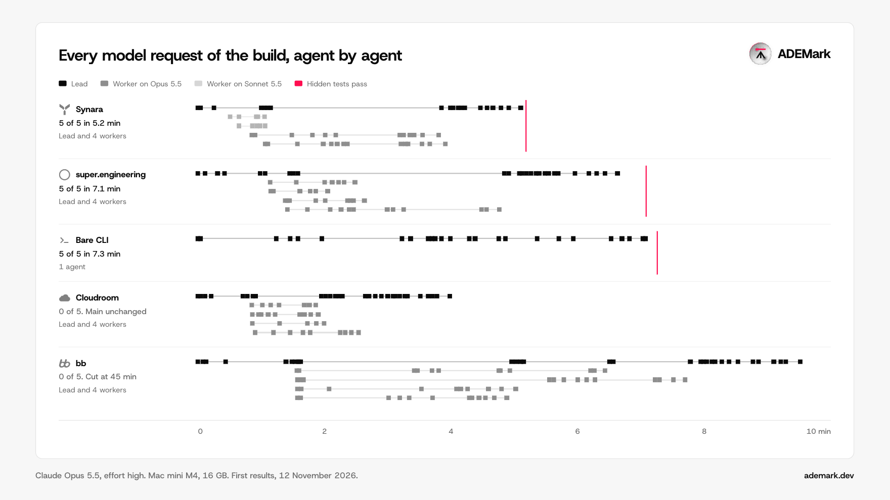

<a href="https://ademark.dev">
  <picture>
    <source media="(prefers-color-scheme: dark)" srcset=".github/readme/banner-dark.png">
    
  </picture>
</a>

<p align="center">
  <a href="https://ademark.dev"><b>Results</b></a>
  &nbsp;·&nbsp;
  <a href="data/">Data</a>
  &nbsp;·&nbsp;
  <a href="METHODOLOGY.md">Method</a>
  &nbsp;·&nbsp;
  <a href="FAIRNESS.md">Fairness</a>
  &nbsp;·&nbsp;
  <a href="https://github.com/zqkra/ademark/issues/new?template=ade-request.yml">Request an ADE</a>
</p>

# ADEMark

ADEMark is an open benchmark of agentic development environments (ADEs), the desktop apps that run coding agents such as Claude Code. v1 measures 15 of them side by side on one Mac: how fast they start and answer, how much memory and CPU they use, how many tokens they send, and how well they run several agents on one job. Every app is compared with a control, Claude Code alone in a terminal.

## Results at a glance

<picture>
  <source media="(prefers-color-scheme: dark)" srcset=".github/readme/overview-dark.png">
  
</picture>

Each test is ranked on its own, so there is no overall winner.

- super.engineering comes first in 4 of the 12 ranked tests: cold start, memory at rest, idle CPU and memory under load. Diri, Paseo and Zeron come first in 2 each, Emdash and T3 Code in 1.
- The terminal still launches first. The Bare CLI is ready 0.69 s after a cold start, and the apps need between 1.76 s and 11.4 s.
- With 5 idle threads, memory goes from 134 MB (super.engineering) to 2,334 MB (Emdash). The Bare CLI uses 1,013 MB.
- A "hi" sends between 22.2K tokens (Paseo) and 77.0K tokens (Emdash). The Bare CLI sends 38.2K.
- In the orchestrated build, Synara and super.engineering passed every hidden test, in 5.2 and 7.1 minutes. bb and Cloudroom each ran a lead and 4 workers and left main unchanged. The Bare CLI passed every test with one agent in 7.3 minutes.

Empty cells are tests an app did not finish or that the harness could not measure. The site gives the cause of each one.

### Speed

<picture>
  <source media="(prefers-color-scheme: dark)" srcset=".github/readme/cold-start-dark.png">
  
</picture>

### Memory

<picture>
  <source media="(prefers-color-scheme: dark)" srcset=".github/readme/memory-at-rest-dark.png">
  
</picture>

### Tokens

<picture>
  <source media="(prefers-color-scheme: dark)" srcset=".github/readme/tokens-hi-dark.png">
  
</picture>

### Orchestration

<picture>
  <source media="(prefers-color-scheme: dark)" srcset=".github/readme/orchestration-dark.png">
  
</picture>

Every chart, the Compare view and the full report are on [ademark.dev](https://ademark.dev).

## What v1 measured

Run `control-2026-11-10T08-31-19Z`, the last complete run, which ended on 12 November 2026. Work began on 18 October.

- 15 ADEs and one control, the Bare CLI (Claude Code alone in Ghostty). The control runs every test and is never ranked.
- One Mac mini M4 with 16 GB on macOS 27, in a macOS user made for the benchmark. Every ADE runs in local mode.
- Claude Opus 5.5 at high effort in every app.
- Track A, speed and weight: launch, new thread, first word, typing lag, long thread, memory, idle CPU and power. A replay server answers in place of the model.
- Track B, tokens: the first request of a "hi", what the ADE adds to it, one real prompt, and whether the repo's `AGENTS.md` reaches the agent.
- Track C, orchestration: one build (C1) where a lead agent splits 4 work items across workers and hidden tests grade the merge. C2 to C6 (message delivery, chat lock, killed agent, network cut, restart) were not part of v1.

Tested as shipped: we added no skills, plugins, MCP servers or instructions. We did set the model, the effort, full access inside the app's worktree and no automatic model routing. Orca, super.engineering and Capy had experimental orchestration switched on for C1 only. Cloud modes were not tested.

The field planned 17 ADEs. The Codex app is not in v1, because the GPT pass has not run. Conductor was measured, but it left the field before publication: its maker was bought, and since 4 November 2026 new users can no longer download the app, so it fails the inclusion rule. Its rows stay in `data/`.

There is no overall winner. Each test is ranked on its own. Tie intervals are not in v1, so two ADEs with close medians may swap places. Gaps are labeled "did not finish" (the app could not complete the test) or "not measured" (our harness could not measure it).

## Where the results are

- The site: [ademark.dev](https://ademark.dev). Its Data section links `results.json`, with medians, ranges and run counts.
- [`data/`](data/): one row per run of every test, with the app versions. Every number on the site can be rebuilt from it with `cd site && bun scripts/results.ts`.

Screen recordings, screenshots and network captures are not published, because they show the reference machine and its account.

## Run the harness

[GUIDE.md](GUIDE.md) is the full procedure: machine setup, measuring an ADE in the field, adding a new one, reading and sharing results. If you hand this repo to a coding agent, it reads [AGENTS.md](AGENTS.md).

A real run needs an Apple Silicon Mac and a dedicated macOS user named `ademark`. The harness refuses to measure in any other account. A dry run works anywhere.

```sh
bun bench/cli.ts run --ade <id> --tracks A --agent claude --dry-run   # any account, measures nothing
bash bench/native/build.sh                                            # the timing and memory helper
cd bench && bun test                                                  # the harness tests
bun bench/cli.ts doctor --agent claude                                # as ademark: checks the machine, changes nothing
bun bench/cli.ts run --ade <id> --tracks A --agent claude             # as ademark: the real run
```

`bun bench/cli.ts help` prints every command. The hidden tests of Track C are not in this repo, only their SHA-256 in `tasks/*/tests/SHA256`, so C1 cannot be graded from a clone. To share results from your Mac, use the [share-results form](https://github.com/zqkra/ademark/issues/new?template=share-results.yml) after the privacy check in GUIDE.md §8.

## Read in this order

1. [METHODOLOGY.md](METHODOLOGY.md): what is measured and why, test IDs, equal conditions, transparency.
2. [TESTS.md](TESTS.md): the exact procedure of every test.
3. [ADES.md](ADES.md): how each ADE is installed, reset, configured, driven and measured.
4. [TASKS.md](TASKS.md): every prompt word for word, the work items and the hidden tests.
5. [RUNBOOK.md](RUNBOOK.md): machine preparation and the run, step by step.
6. [FAIRNESS.md](FAIRNESS.md): objections and answers.
7. [BUSINESS.md](BUSINESS.md): funding by donations, and what money never buys.

Changes: [CHANGELOG.md](CHANGELOG.md).

## Layout

| Path | Contents |
|---|---|
| `arena/` | Ledger, the TypeScript repository every agent works in |
| `tasks/` | Prompts, task settings and the SHA-256 of each hidden test |
| `bench/` | The harness: sampler, timer, replay server, capture, fault injector, adapters, Control panel |
| `data/` | The published v1 data |
| `site/` | The ademark.dev site (Astro) |
| `brand/` | Mark, orb and app icons |
| `prices/` | The API price table used for dollar figures |
| `.github/` | Issue forms and the images of this README |
| `results/` | Gitignored. Raw rows of your own local runs |

## Request an ADE or report a number

[Request an ADE](https://github.com/zqkra/ademark/issues/new?template=ade-request.yml) and vote on requests with a thumbs up. If a number looks wrong, [open a wrong-number issue](https://github.com/zqkra/ademark/issues/new?template=wrong-number.yml). See [CONTRIBUTING.md](CONTRIBUTING.md).

## License

The code is licensed under Apache-2.0 ([LICENSE](LICENSE)). The published data is licensed under CC BY 4.0 ([LICENSE-DATA](LICENSE-DATA)). The ADEMark name and logo are not covered by either license.
